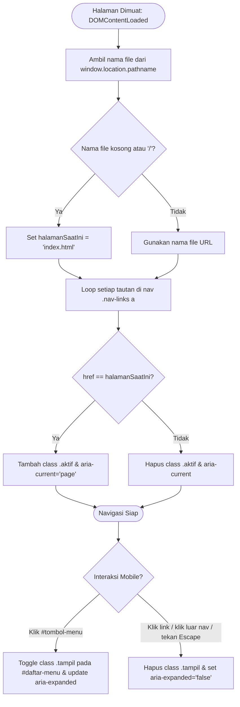
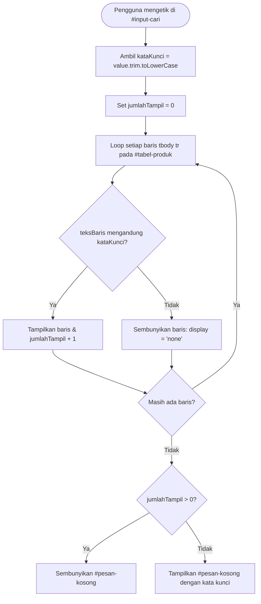
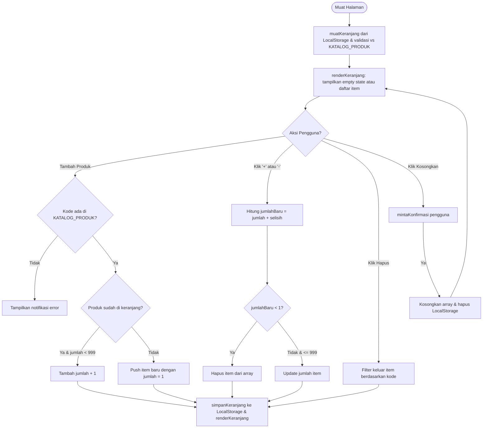
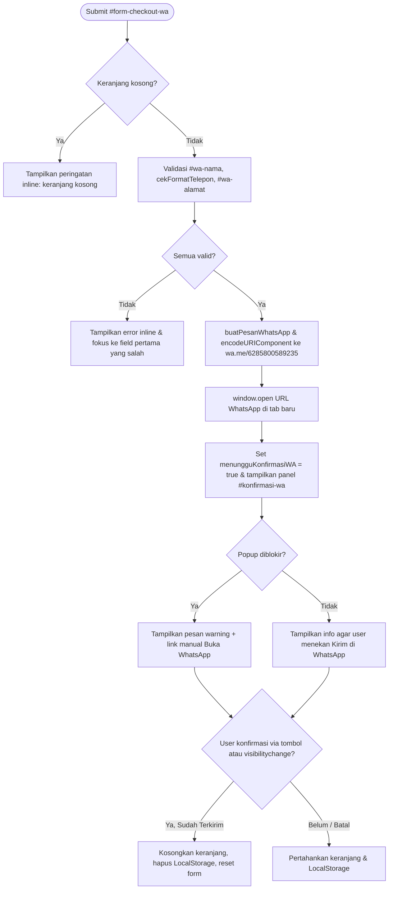
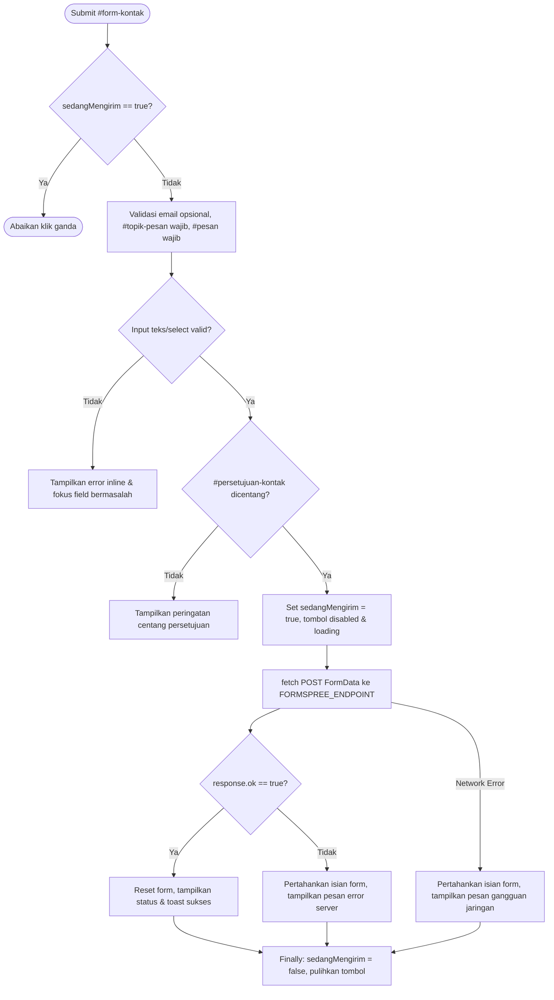

# LAPORAN DATA TAMBAHAN — PROYEK WEBSITE CAMILAN NUSANTARA (KELOMPOK 6)

Dokumen ini disusun berdasarkan inspeksi langsung terhadap source code aktual (`index.html`, `produk.html`, `artikel.html`, `kontak.html`, `biodata.html`, `css/style.css`, `js/main.js`), dokumentasi proyek (`Data.md`, `README.md`), timestamp berkas lokal, direktori Tugas 1 (`../Kelompok 6 - Tugas 1`), dan riwayat Git (`git log`).

---

## A. Flowchart dan Pseudocode

### 1. Alur Navigasi Halaman (`highlightMenu()` & `aturMenuMobile()`)

**Penjelasan Singkat:**
Saat halaman dimuat (`DOMContentLoaded`), `highlightMenu()` mengambil nama file dari URL saat ini (default `index.html` jika kosong/`/`), lalu mencocokkannya dengan atribut `href` di `nav .nav-links a` untuk menambahkan kelas `.aktif` dan `aria-current="page"`. Pada tampilan mobile, `aturMenuMobile()` membuka atau menutup `#daftar-menu` saat `#tombol-menu` diklik sambil memperbarui `aria-expanded`, serta menutup menu otomatis ketika pengguna memilih tautan menu, mengklik area di luar `<nav>`, atau menekan tombol `Escape`.



**Pseudocode:**
```text
FUNGSI highlightMenu()
  ambil semua tautan menuLinks di "nav .nav-links a"
  halamanSaatIni <- nama file terakhir dari window.location.pathname
  JIKA halamanSaatIni == "" ATAU halamanSaatIni == "/" MAKA
    halamanSaatIni <- "index.html"
  AKHIR JIKA
  UNTUK SETIAP link DALAM menuLinks LAKUKAN
    JIKA link.href == halamanSaatIni MAKA
      tambahkan class "aktif" dan atribut aria-current="page"
    LAINNYA
      hapus class "aktif" dan atribut aria-current
    AKHIR JIKA
  AKHIR UNTUK
AKHIR FUNGSI

FUNGSI aturMenuMobile()
  SAAT tombolMenu DIKLIK:
    terbuka <- toggle class "tampil" pada daftarMenu
    set aria-expanded tombolMenu sesuai nilai terbuka
  SAAT link menu DIKLIK ATAU klik di luar nav ATAU tombol Escape DITEKAN:
    hapus class "tampil" dari daftarMenu dan set aria-expanded="false"
AKHIR FUNGSI
```

---

### 2. Alur Pencarian Produk (`aturPencarianTabel()`)

**Penjelasan Singkat:**
Setiap kali pengguna mengetik pada input `#input-cari` (`event input`), teks pencarian diubah menjadi huruf kecil (`trim().toLowerCase()`). Fungsi kemudian memeriksa setiap baris `tbody tr` pada `#tabel-produk`. Baris yang teksnya mengandung kata kunci ditampilkan, sedangkan yang tidak cocok disembunyikan. Jika `jumlahTampil === 0`, elemen `#pesan-kosong` dimunculkan dengan pesan informatif.



**Pseudocode:**
```text
FUNGSI aturPencarianTabel()
  JIKA inputCari TIDAK ADA ATAU tabel TIDAK ADA MAKA KELUAR
  SAAT event "input" PADA inputCari:
    kataKunci <- huruf kecil dari trim(inputCari.value)
    jumlahTampil <- 0
    UNTUK SETIAP baris DALAM tabel "tbody tr" LAKUKAN
      JIKA huruf kecil dari baris.textContent MENGANDUNG kataKunci MAKA
        baris.style.display <- ""
        jumlahTampil <- jumlahTampil + 1
      LAINNYA
        baris.style.display <- "none"
      AKHIR JIKA
    AKHIR UNTUK
    JIKA jumlahTampil == 0 MAKA
      tampilkan pesanKosong (dengan kata kunci jika tidak kosong)
    LAINNYA
      sembunyikan pesanKosong
    AKHIR JIKA
AKHIR FUNGSI
```

---

### 3. Alur Penambahan dan Pengelolaan Keranjang (`muatKeranjang()`, `tambahKeKeranjang()`, `ubahJumlahItem()`, `hapusItemKeranjang()`, `kosongkanKeranjangPenuh()`)

**Penjelasan Singkat:**
Saat halaman dimuat, `muatKeranjang()` membaca data `LocalStorage` (`camilanNusantara_keranjang`), memvalidasi format JSON serta mencocokkan kode produk terhadap `KATALOG_PRODUK` dengan kuantitas `1–999`. Saat tombol `+ Tambah ke Pesanan` atau `+ Pesan` ditekan, item ditambahkan atau kuantitasnya dinaikkan (`+1`), disimpan ke `LocalStorage`, dan dirender aman ke DOM menggunakan `document.createElement` + `textContent` beserta pembaruan badge/total. Pengguna juga dapat mengubah jumlah (`+`/`-`), menghapus item, atau mengosongkan keranjang melalui konfirmasi.



**Pseudocode:**
```text
FUNGSI muatKeranjang()
  COBA baca JSON dari localStorage["camilanNusantara_keranjang"]
  JIKA bukan array ATAU gagal parse MAKA KEMBALIKAN []
  hasilValid <- []
  UNTUK SETIAP item DALAM data LAKUKAN
    JIKA item.kode ADA DI KATALOG_PRODUK DAN item.jumlah integer 1..999 MAKA
      tambahkan { kode, nama, harga dari KATALOG_PRODUK, jumlah: item.jumlah } ke hasilValid
    AKHIR JIKA
  AKHIR UNTUK
  KEMBALIKAN hasilValid
AKHIR FUNGSI

FUNGSI tambahKeKeranjang(kodeProduk)
  produk <- KATALOG_PRODUK[kodeProduk]
  JIKA produk TIDAK ADA MAKA tampilkanNotifikasi("error") DAN KEMBALIKAN false
  cari itemAda di keranjangBelanja dengan kode == kodeProduk
  JIKA itemAda DITEMUKAN MAKA
    JIKA itemAda.jumlah >= 999 MAKA tampilkanNotifikasi("warning") DAN KEMBALIKAN false
    itemAda.jumlah <- itemAda.jumlah + 1
  LAINNYA
    tambahkan { kode, nama, harga, jumlah: 1 } ke keranjangBelanja
  AKHIR JIKA
  simpanKeranjang(keranjangBelanja)
  renderKeranjang(true)
  tampilkanNotifikasi("success")
AKHIR FUNGSI

FUNGSI ubahJumlahItem(kodeProduk, selisih)
  cari index item dengan kode == kodeProduk
  JIKA tidak ditemukan MAKA tampilkanNotifikasi("error") DAN KELUAR
  jumlahBaru <- keranjangBelanja[index].jumlah + selisih
  JIKA jumlahBaru < 1 MAKA hapus item dari keranjangBelanja
  JIKA jumlahBaru <= 999 MAKA set jumlah item <- jumlahBaru
  simpanKeranjang(keranjangBelanja)
  renderKeranjang(true)
AKHIR FUNGSI
```

---

### 4. Alur Checkout WhatsApp (`aturPemesananWhatsApp()`, `buatPesanWhatsApp()`, `buatUrlCheckoutWA()`)

**Penjelasan Singkat:**
Ketika form `#form-checkout-wa` disubmit, sistem memeriksa apakah keranjang berisi minimal 1 produk, lalu memvalidasi nama, format telepon (`9–15` digit angka setelah membersihkan spasi dan `-`), dan alamat pengiriman secara inline. Jika valid, `buatPesanWhatsApp()` menyusun rincian pesanan dan `buatUrlCheckoutWA()` meng-encode teks ke `https://wa.me/6285800589235?text=...`. WhatsApp dibuka di tab baru (`noopener,noreferrer`), atau menampilkan tautan manual jika popup diblokir. Keranjang **tetap tersimpan** hingga pengguna mengonfirmasi melalui panel `#konfirmasi-wa` atau dialog `visibilitychange` bahwa pesan benar-benar telah dikirim di WhatsApp.



**Pseudocode:**
```text
SAAT #form-checkout-wa DISUBMIT:
  cegah reload default
  JIKA keranjangBelanja KOSONG MAKA
    tampilkanStatusForm("warning", "Keranjang masih kosong") DAN KELUAR
  AKHIR JIKA
  validasi nama tidak kosong, cekFormatTelepon(telepon) == true, alamat tidak kosong
  JIKA ada yang tidak valid MAKA
    tampilkan error inline pada tiap field bermasalah, fokus ke field pertama, KELUAR
  AKHIR JIKA

  pesan <- buatPesanWhatsApp(keranjangBelanja, dataPelanggan)
  urlWhatsApp <- "https://wa.me/6285800589235?text=" + encodeURIComponent(pesan)
  jendelaWA <- window.open(urlWhatsApp, "_blank", "noopener,noreferrer")
  menungguKonfirmasiWA <- true
  tampilkan panel #konfirmasi-wa

  JIKA jendelaWA TIDAK TERBUKA MAKA
    tampilkan tautan manual urlWhatsApp di #status-checkout
  AKHIR JIKA

  SAAT user klik "Ya, Sudah Terkirim" ATAU (kembali ke tab via visibilitychange DAN konfirmasi Ya):
    kosongkanKeranjangPenuh() // hapus array & localStorage
    sembunyikan #konfirmasi-wa, reset form, tampilkan status sukses
  SAAT user klik "Belum / Batal" ATAU konfirmasi Tidak:
    pertahankan keranjangBelanja & localStorage, sembunyikan #konfirmasi-wa
AKHIR PROSES
```

---

### 5. Alur Formulir Kritik dan Saran (`aturValidasiForm()`)

**Penjelasan Singkat:**
Saat `#form-kontak` di `kontak.html` disubmit, flag `sedangMengirim` mencegah pengiriman ganda. Sistem memvalidasi format email (hanya jika diisi, karena opsional), dropdown `#topik-pesan`, isi `#pesan` (wajib), dan checkbox `#persetujuan-kontak`. Jika valid, tombol masuk ke state loading (`disabled`, class `.sedang-loading`, teks `"Mengirim..."`) dan mengirim `FormData` via `fetch()` (`POST`, header `Accept: application/json`) ke `FORMSPREE_ENDPOINT`. Form hanya di-reset apabila `response.ok` bernilai benar; bila gagal atau terjadi gangguan jaringan, ketikan pengguna tetap dipertahankan.



**Pseudocode:**
```text
SAAT #form-kontak DISUBMIT:
  cegah reload default
  JIKA sedangMengirim == true MAKA KELUAR
  JIKA email != "" DAN format email tidak valid MAKA tandai error email
  JIKA topik == "" MAKA tandai error topik
  JIKA pesan == "" MAKA tandai error pesan
  JIKA ada error input MAKA fokus ke input pertama DAN KELUAR
  JIKA persetujuan tidak dicentang MAKA tampilkan warning DAN KELUAR

  sedangMengirim <- true
  nonaktifkan tombol submit, tampilkan spinner & teks "Mengirim..."
  KIRIM fetch(FORMSPREE_ENDPOINT, method: "POST", body: FormData(form), Accept: "application/json")
    JIKA response.ok == true MAKA
      reset form
      tampilkanStatusForm("success") & tampilkanNotifikasi("success")
    LAINNYA
      pertahankan isi form & tampilkan pesan error server
    JIKA TERJADI NETWORK ERROR (catch):
      pertahankan isi form & tampilkan pesan gangguan koneksi
    AKHIRNYA (finally):
      sedangMengirim <- false
      aktifkan kembali tombol submit & kembalikan teks "Kirim"
AKHIR PROSES
```

---

## B. Timeline Pengerjaan Aktual (Berdasarkan Bukti Workspace & Riwayat Git)

> **Catatan Bukti:** Repository Git baru diinisialisasi pada tanggal `2026-11-25 22:59`. Oleh karena itu, aktivitas sebelum tanggal tersebut dibuktikan melalui tag `<time>` di `artikel.html`, timestamp folder `../Kelompok 6 - Tugas 1`, dan timestamp pembuatan/modifikasi berkas di `Kelompok 6 _ Tugas 2`.

| Tanggal / Rentang Waktu | Tahap Pengerjaan | Aktivitas yang Dilakukan | File / Fitur yang Dikerjakan | PIC (Berdasarkan Bukti) |
|---|---|---|---|---|
| `2026-10-31` | Persiapan Konten Artikel | Penyusunan artikel bisnis ritel makanan ringan kemasan | `artikel.html` (`<time datetime="2026-10-31">`) | Tahta Alfina Pagelaran *(tercatat di `<meta author>` & byline artikel)* |
| `2026-11-02` (`21:58 – 22:31`) | Penyelesaian Tugas 1 | Pembuatan 5 halaman HTML5 semantik dasar, CSS ringkas awal, integrasi `music.mp3`, & penyusunan PDF laporan | `../Kelompok 6 - Tugas 1/` (`index.html`, `produk.html`, `artikel.html`, `kontak.html`, `biodata.html`, `style.css`, `upload/music.mp3`, `upload/Laporan.pdf`) | Per halaman sesuai pembagian tugas resmi di `biodata.html`; PIC pengolah `music.mp3` & `Laporan.pdf` **Belum teridentifikasi** secara spesifik |
| `2026-11-20` (`15:34 – 16:03`) | Inisiasi & Revisi Awal Tugas 2 | Pembentukan direktori `css/`, `js/`, `upload/gambar/`; penambahan `js/main.js` global; section `Profil Kelompok`; serta pembuatan `Data.md` | `css/style.css`, `js/main.js`, `Data.md`, `index.html`, `produk.html`, `artikel.html`, `kontak.html`, `biodata.html` | **Belum teridentifikasi** *(dikerjakan di workspace lokal sebelum Git diinisialisasi)* |
| `2026-11-25` (`14:14 – 21:49`) | Audit, Fitur Keranjang WA, Gambar Lokal, & Penyederhanaan Form | Pemulihan `laporan/Laporan.pdf`; implementasi keranjang `LocalStorage` & checkout WA (`0858-0058-9235`); penambahan 3 gambar lokal; ringkas katalog `<details>`; penyederhanaan form menjadi Kritik & Saran | `laporan/Laporan.pdf`, `upload/gambar/*.jpg`, `produk.html`, `kontak.html`, `js/main.js`, `css/style.css`, `Data.md` | **Belum teridentifikasi** *(penyediaan 3 foto lokal di `upload/gambar/` pada `21:40–21:41` tidak memiliki catatan nama pengunggah di Git)* |
| `2026-11-25` (`22:01 – 22:46`) | Integrasi Formspree, Recovery Tugas 1, UI Polish, & Dokumentasi | Integrasi Formspree (`mqpqnloy` di `js/main.js`); pemulihan `<select>` & `<checkbox>` di `kontak.html`; perbaikan heading; penambahan SweetAlert2 + fallback lokal; finalisasi nama dosen; pembuatan `README.md` | `kontak.html`, `produk.html`, `artikel.html`, `biodata.html`, `index.html`, `css/style.css`, `js/main.js`, `Data.md`, `README.md` | Penetapan endpoint `mqpqnloy` & nama dosen oleh pengelola workspace; **Belum teridentifikasi** rincian per-anggota di Git |
| `2026-11-25` (`22:59 – 23:36`) | Publikasi GitHub & GitHub Pages | Inisialisasi repository Git (`Initial commit - Camilan Nusantara`), pembuatan `.gitignore`, dan commit `Rebuild GitHub Pages` | Seluruh 15 file proyek pada commit `3cbea9de` dan `.gitignore`, `README.md` pada commit `12b65f2e` | **Diva Islamy R** (`Divarzky` — terbukti dari `git log` author) |

---

## C. PIC dan Kontribusi Anggota

| Nama Anggota | NIM | Halaman / Fokus Resmi | Bukti di Dokumentasi / Kode | Kontribusi Tambahan Terbukti di Riwayat Git |
|---|---|---|---|---|
| **Gladis Ayu Diapitaloka** | `25104410073` | Beranda (`index.html`) | Tercatat di `<meta author>` `index.html`, tabel `biodata.html`, & `Data.md`. | Belum teridentifikasi di `git log` *(seluruh file di-commit sekaligus pada `Initial commit`)*. |
| **Aswin Akmal Rizantha** | `25104410058` | Katalog Produk (`produk.html`) | Tercatat di `<meta author>` `produk.html`, tabel `biodata.html`, & `Data.md`. | Belum teridentifikasi di `git log`. |
| **Tahta Alfina Pagelaran** | `25104410040` | Artikel Edukasi (`artikel.html`) | Tercatat di `<meta author>`, byline artikel `artikel.html`, tabel `biodata.html`, & `Data.md`. | Belum teridentifikasi di `git log`. |
| **Fajar Dwi Prayitno** | `25104410048` | Kontak & Layanan (`kontak.html`) | Tercatat di `<meta author>` `kontak.html`, tabel `biodata.html`, & `Data.md`. | Belum teridentifikasi di `git log`. |
| **Diva Islamy Rizky Akbar** | `25104410033` | Biodata & Laporan (`biodata.html`) | Tercatat di `<meta author>` `biodata.html`, tabel `biodata.html`, & `Data.md`. | **Terbukti:** Author pada kedua commit Git (`3cbea9de` & `12b65f2e`) serta pemilik remote repository `Divarzky/Ritel-Camilan-dan-Snack-Kelompok-6.git`. |

---

## D. Pengujian Final (Aman & Tanpa Mengirim Data Sungguhan)

Pengujian dilakukan pada `2026-11-26` terhadap kode aktual tanpa mengirim request ke server Formspree maupun membuka pesan WhatsApp sungguhan:

| No. | Fitur yang Diuji | Langkah Pengujian | Hasil Aktual | Status | Catatan |
|---|---|---|---|---|---|
| 1 | Sintaksis JavaScript & Aset Lokal | Menjalankan `node -c js/main.js` dan skrip Python pengecekan seluruh `href`/`src`, link `_blank`, dan *inline style* pada 5 halaman HTML. | `node -c` keluar kode `0`; seluruh aset lokal (`css/style.css`, `js/main.js`, `basreng.jpg`, `kripikkaca.jpg`, `makaronipedas.jpg`, `music.mp3`, `Laporan.pdf`) tersedia; 0 *inline style*; semua `_blank` ber-`noopener noreferrer`. | **PASS** | Terverifikasi langsung di disk. |
| 2 | Penambahan, Pengubahan, & Penghapusan Keranjang | Menjalankan simulasi Node.js (`vm` + mock DOM) memanggil `tambahKeKeranjang("CN-BS01")` (dan kode tidak valid), cek penggabungan kuantitas, dan validasi elemen `#wadah-toast` fallback saat `Swal` undefined. | Item tidak valid ditolak dengan notifikasi error; item valid menambah keranjang & badge, memicu notifikasi toast fallback lokal. | **PASS** | Diuji pada simulasi DOM Node.js (bukan browser live). |
| 3 | Persistensi & Keamanan `LocalStorage` | Menyimpan JSON korup (`"{json-rusak"`) dan item dengan kode palsu (`"PALSU"`) lalu memanggil `muatKeranjang()`. | JSON korup mengembalikan `[]` tanpa crash; item valid (`CN-BS01`) tetap dimuat dengan harga resmi dari `KATALOG_PRODUK` (`Rp8.000`), item palsu diabaikan. | **PASS** | Terverifikasi pada `test_main.js`. |
| 4 | Checkout WhatsApp & Pengosongan Keranjang Aman | Menguji submit `#form-checkout-wa` saat popup diblokir (`window.open` return `null`), saat terbuka normal, lalu menekan `#btn-wa-sukses`. | Saat popup diblokir muncul link manual `Buka WhatsApp Sekarang`; saat terbuka keranjang tetap ada sampai `#btn-wa-sukses` diklik baru `LocalStorage` terhapus (`null`). | **PASS** | URL `wa.me/6285800589235?text=...` diverifikasi tanpa mengirim pesan nyata. |
| 5 | Validasi Input & Alur `fetch()` Formspree (Mock) | Menguji submit `#form-kontak` pada kondisi mock `fetch` sukses dan mock `fetch` gagal jaringan, serta memverifikasi status loading `.sedang-loading`. | Saat loading tombol `disabled` + `.sedang-loading`; saat sukses form di-reset & tampil pesan berhasil; saat jaringan gagal pesan ketikan pengguna (`"Mohon dipercepat."`) tetap terjaga. | **PASS** | Mock `fetch` di Node.js; pengiriman ke server Formspree asli tidak dilakukan. |
| 6 | Konsistensi Fallback `action` HTML vs `FORMSPREE_ENDPOINT` JS | Membandingkan `action` pada `<form id="form-kontak">` di `kontak.html` baris 98 dengan `FORMSPREE_ENDPOINT` di `js/main.js` baris 11. | `js/main.js` menggunakan `https://formspree.io/f/mqpqnloy`, sedangkan `action` HTML di `kontak.html` masih tertulis `https://formspree.io/f/xeagnzdd`. | **FAIL** | Tidak berdampak selama JS aktif, namun tidak konsisten bila JS nonaktif. *(Tidak diubah karena batasan tugas audit).* |
| 7 | Navigasi Live, Pencarian Tabel Live, Responsivitas Visual (Desktop/Tablet/Mobile), Audio, YouTube `iframe`, & Pengiriman Live Formspree/WA | Membuka seluruh halaman di Google Chrome nyata pada berbagai viewport serta menguji interaksi live. | Belum dijalankan pada sesi ini karena koneksi Chrome DevTools tidak tersedia dan dilarang mengirim data/email sungguhan. | **NOT VERIFIED** | Disarankan diuji manual melalui Live Server sebelum presentasi. |

---

## E. Kendala dan Solusi Nyata

| Kategori | Kendala | Penyebab | Dampak | Solusi yang Diterapkan | Bukti / File Terkait |
|---|---|---|---|---|---|
| **1. UI / Desain** | Inkonsistensi tema pada draf awal & halaman katalog menjadi terlalu panjang setelah ditambah kartu produk, tabel 7 varian, dan keranjang. | Lima halaman awalnya dikerjakan terpisah dengan gaya berbeda, lalu penambahan fitur Tahap 2 memperpanjang konten `produk.html`. | Pengunjung sulit memindai produk utama dan pengalaman antarhalaman kurang seragam. | Penyeragaman tema Vintage Nusantara (`#fdfbf7`, `#fdf6ee`, `#8B4513`, `#d97706`) di `css/style.css` dan penerapan *progressive disclosure* memakai `<details>` pada keranjang, tabel harga, serta detail kategori di `produk.html`. | `biodata.html` baris 199; `css/style.css`; `produk.html` baris 86–316. |
| **2. Coding** | Penyederhanaan formulir kontak sempat menghapus `<select>` dan `<input type="checkbox">` (persyaratan Tugas 1) serta validasi telepon `isNaN()` menolak tanda hubung (`0812-3456-7890`). | Fokus penyederhanaan UX menjadi form Kritik & Saran sempat menghilangkan dua tipe input wajib, dan pengecekan angka belum membersihkan pemisah `-`/spasi. | Berisiko mengurangi kelengkapan nilai Tugas 1 Anggota 4 dan menolak format nomor telepon yang wajar. | Pemulihan dropdown `<select name="topik">` dan `<input type="checkbox" name="konfirmasi">` pada `kontak.html`, serta fungsi `cekFormatTelepon()` memakai `.replace(/[\s-]/g, "")` di `js/main.js`. | `kontak.html` baris 114–138; `js/main.js` baris 191–194; `Data.md` baris 96. |
| **3. Integrasi / Pengujian** | Ketiadaan backend membuat pengiriman formulir `mailto:` bergantung aplikasi email perangkat, dan keranjang berisiko terhapus jika pengguna batal mengirim WhatsApp. | Website bersifat statis (*client-side*), sementara browser tidak bisa mendeteksi apakah pengguna benar-benar menekan *Send* di aplikasi WhatsApp. | Formulir `mailto:` tidak andal di browser tanpa klien email, dan penghapusan keranjang otomatis berisiko menghilangkan pesanan pengguna. | Penggantian alur kritik & saran ke Formspree via `fetch()` dengan loading state & fallback notifikasi lokal jika CDN SweetAlert2 gagal; serta mekanisme konfirmasi pascakirim (`#konfirmasi-wa` & `visibilitychange`) sebelum menghapus `LocalStorage`. | `js/main.js` baris 71–143, 250–318, 616–849; `README.md`. |
| **4. Manajemen Waktu / Koordinasi** | Pemindahan alur pesan ke `produk.html` sempat meninggalkan teks arahan lama (*stale copy*) di beberapa halaman, dan riwayat Git baru dibuat menjelang akhir pengerjaan. | Perubahan fitur antarhalaman berjalan cepat di lokal sebelum sinkronisasi Git dilakukan pada `2026-11-25 22:59`. | Informasi di `<aside>` beranda, FAQ kontak, dan refleksi biodata sempat tidak sinkron dengan fitur terbaru, serta kontribusi historis per anggota tidak terekam di commit Git. | Sinkronisasi ulang narasi pada `index.html`, `produk.html`, `kontak.html`, `biodata.html`, `Data.md`, dan `README.md`. Untuk rincian pembagian waktu kerja harian tiap anggota sebelum `2026-11-25`: **Perlu konfirmasi anggota**. | `git log`; `index.html` baris 131; `kontak.html` baris 47; `biodata.html` baris 202. |

---

## F. Ringkasan Kelengkapan Data Laporan

### 1. Data yang Berhasil Ditemukan
- Seluruh arsitektur dan alur logika aktual (navigasi, pencarian tabel, keranjang `LocalStorage`, checkout WhatsApp, dan Formspree Kritik & Saran) dari `js/main.js` serta HTML terkait.
- Identitas lengkap akademik (Kelompok 6, TI B, Unisba Blitar, Dosen Pengampu **Abdi Pandu Kusuma, S.Kom, M.T.**, serta 5 nama & NIM anggota).
- Bukti timestamp pengerjaan Tugas 1 (`2026-11-02`) di `../Kelompok 6 - Tugas 1`, tanggal artikel (`2026-10-31`), inisiasi & revisi Tugas 2 (`2026-11-20` s.d. `2026-11-25`), serta 2 commit Git (`3cbea9de` dan `12b65f2e` oleh `Diva Islamy R` / `Divarzky`).
- Hasil verifikasi otomatis sintaksis JS, keutuhan seluruh asset lokal (termasuk 3 gambar baru di `upload/gambar/`), simulasi DOM/LocalStorage/Formspree/WA, dan temuan ketidaksinkronan atribut `action` di `kontak.html` (`xeagnzdd` vs `mqpqnloy` di `js/main.js`).

### 2. Data yang Belum Tersedia
- Riwayat commit Git per tahap selama masa pengerjaan awal (sebelum `2026-11-25 22:59`) karena repository Git baru diinisialisasi saat publikasi akhir.
- Hasil pengujian visual live di browser (Chrome/Edge/Firefox) pada 5 ukuran viewport, pemutaran langsung video YouTube Shorts & audio `music.mp3`, serta respons pengiriman email sungguhan ke server Formspree dan WhatsApp.

### 3. Data yang Perlu Dikonfirmasi oleh Anggota Kelompok
1. **Rincian Timeline & Kontribusi Personal:** Tanggal pasti pengerjaan masing-masing anggota antara `2026-11-02` hingga `2026-11-25`, serta siapa PIC pengambil/penyedia 3 foto produk (`basreng.jpg`, `kripikkaca.jpg`, `makaronipedas.jpg`), `music.mp3`, dan penyusun `Laporan.pdf`.
2. **Kendala Non-Teknis / Koordinasi:** Detail kendala manajemen waktu atau komunikasi kelompok di luar catatan `biodata.html` jika ingin ditambahkan ke bab Kendala dan Solusi laporan.
3. **Konfirmasi Endpoint `kontak.html`:** Konfirmasi apakah atribut `action` HTML di `kontak.html` (`xeagnzdd`) perlu disamakan dengan `FORMSPREE_ENDPOINT` di `js/main.js` (`mqpqnloy`) sebelum pengumpulan final.
4. **Pengujian Live Akhir:** Hasil uji coba langsung di browser/Live Server oleh anggota kelompok (termasuk memastikan email Formspree masuk ke `canusblt@gmail.com` dan WhatsApp terbuka menuju `0858-0058-9235`).

